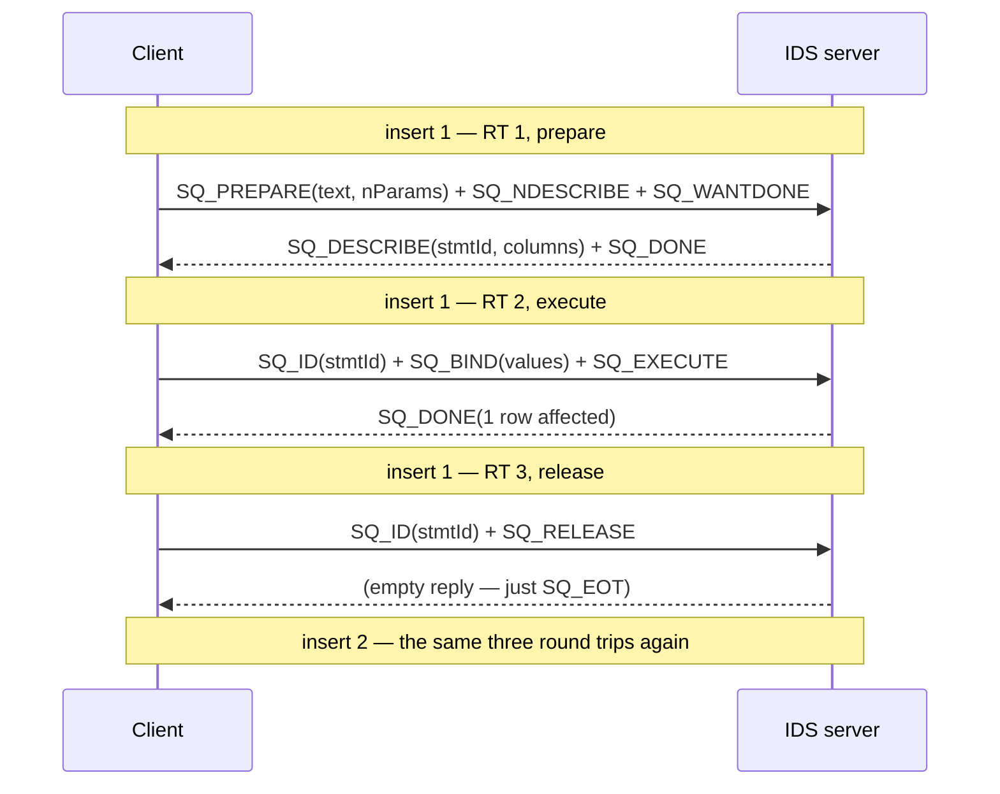
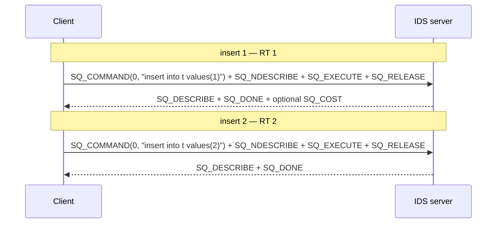
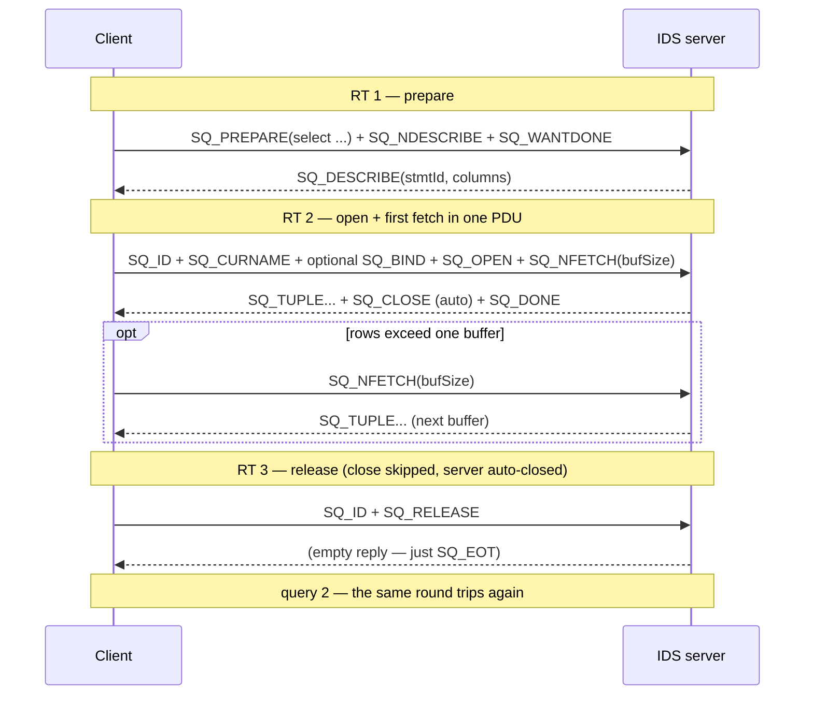
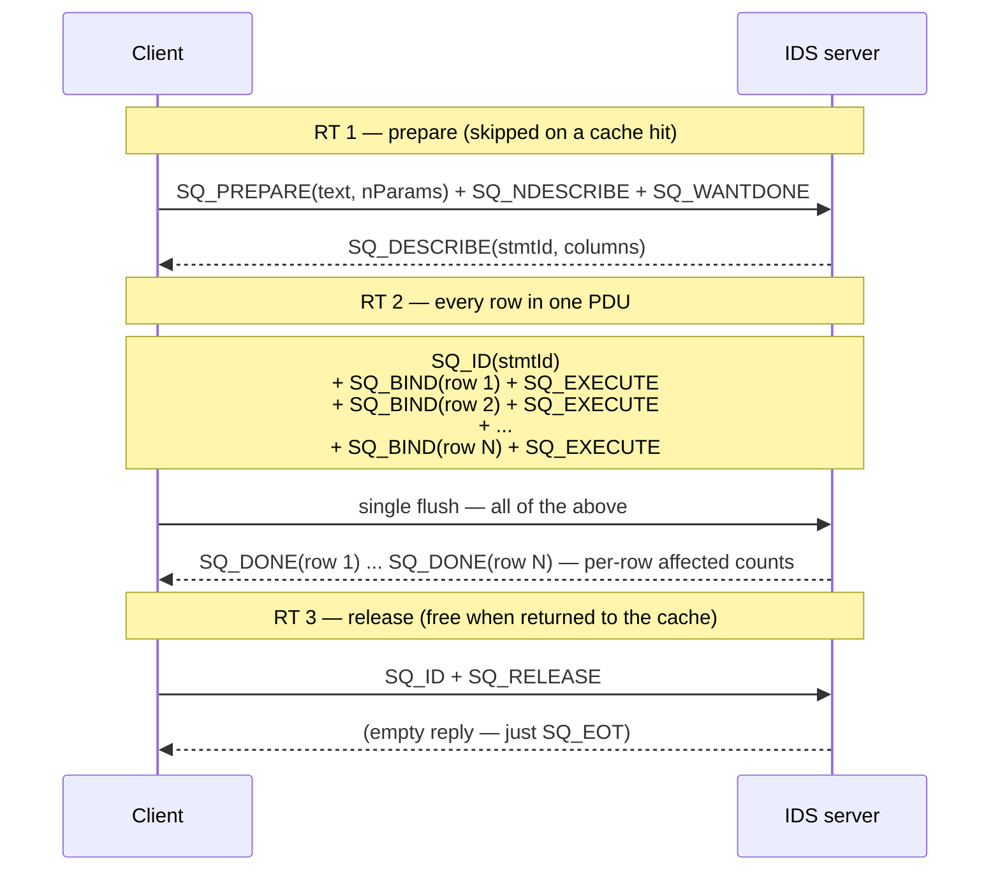
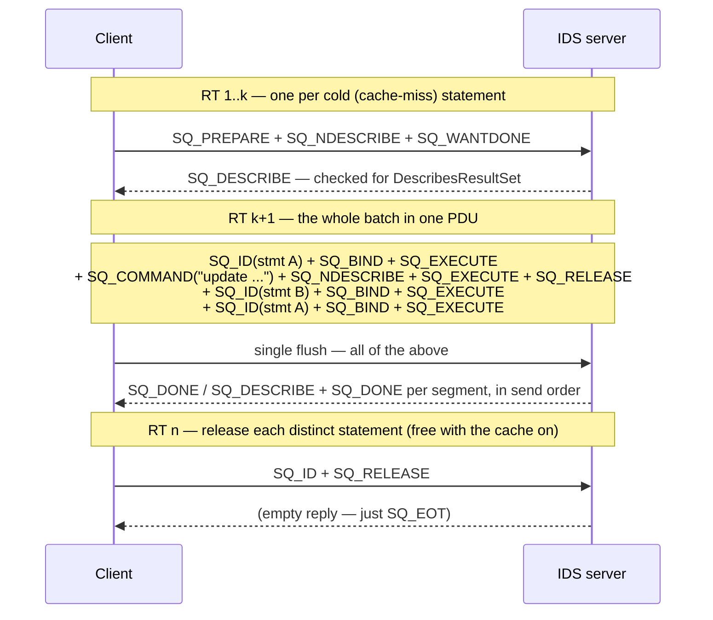
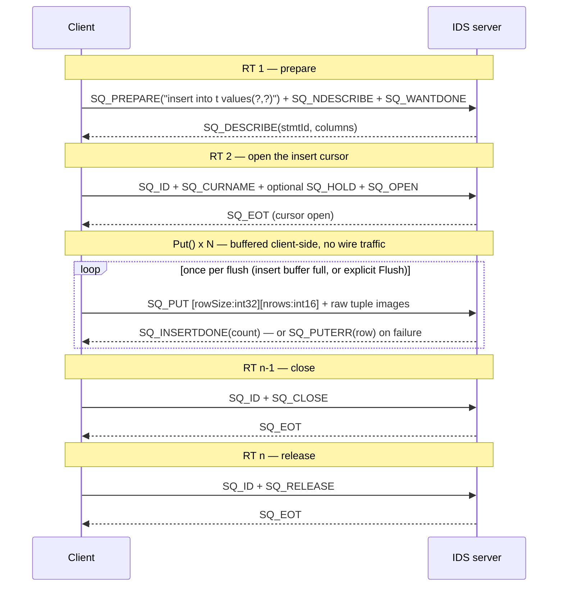
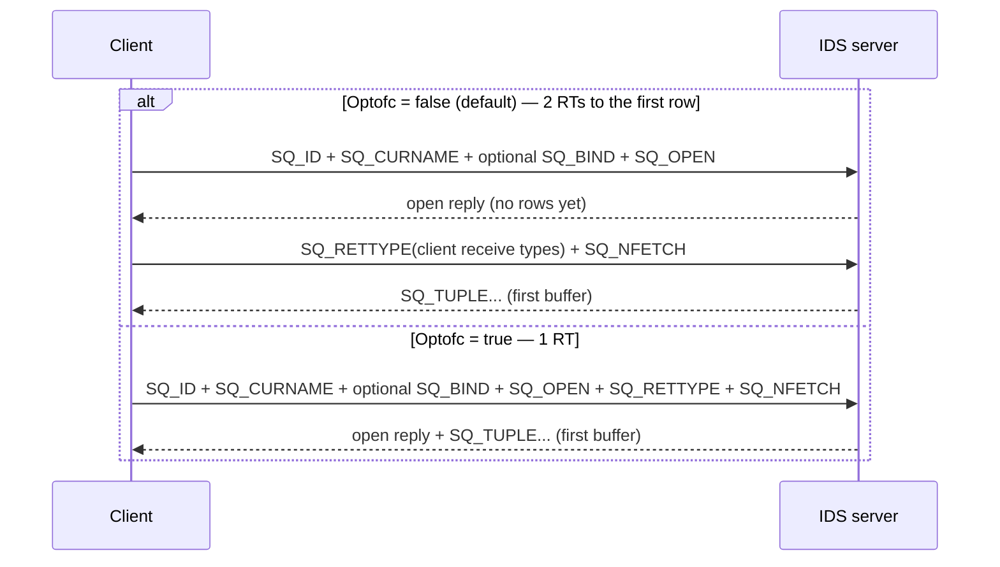
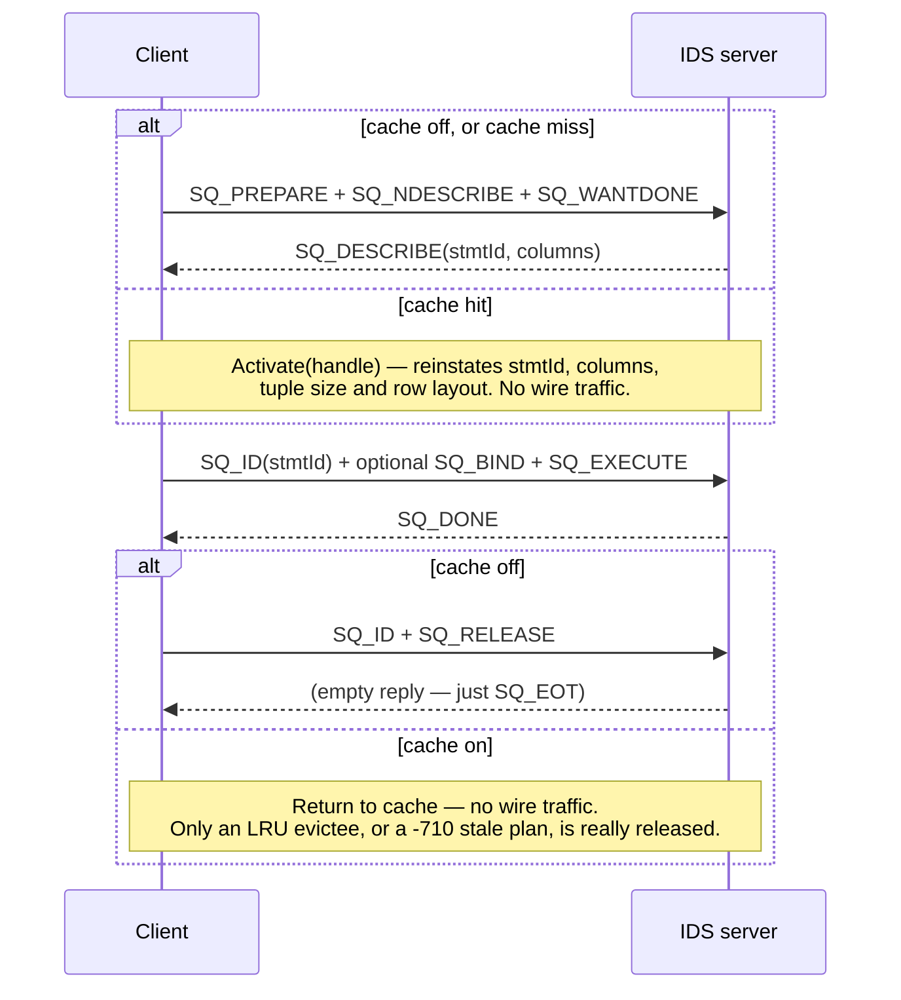
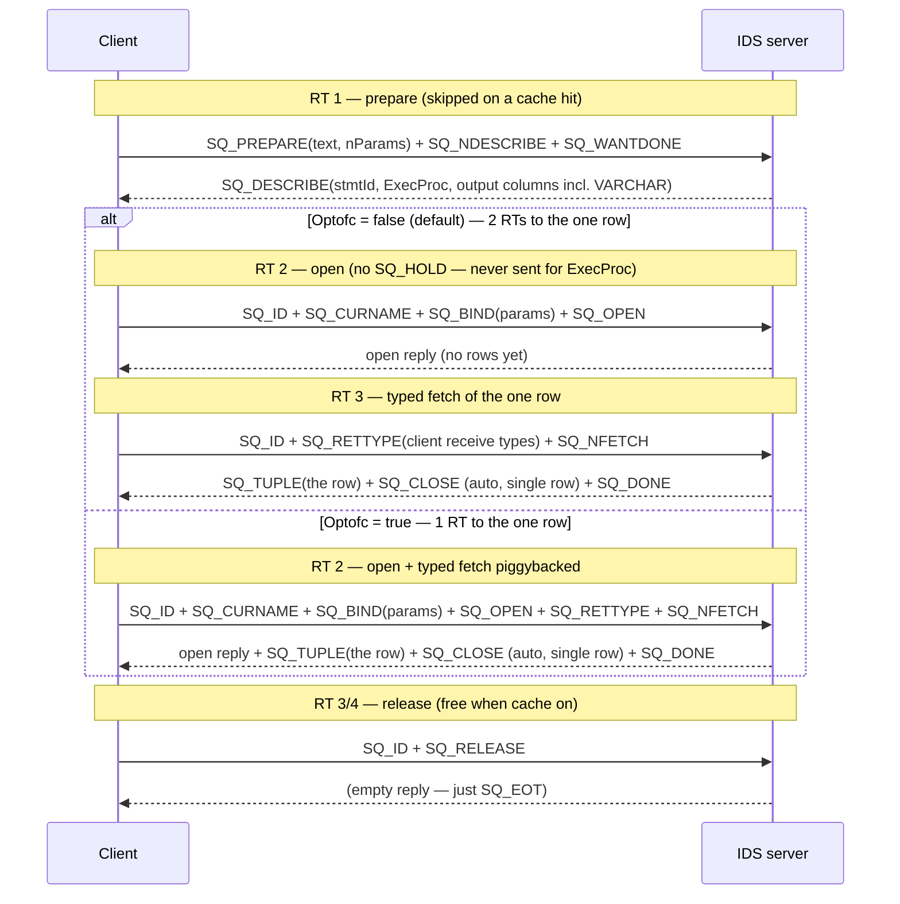
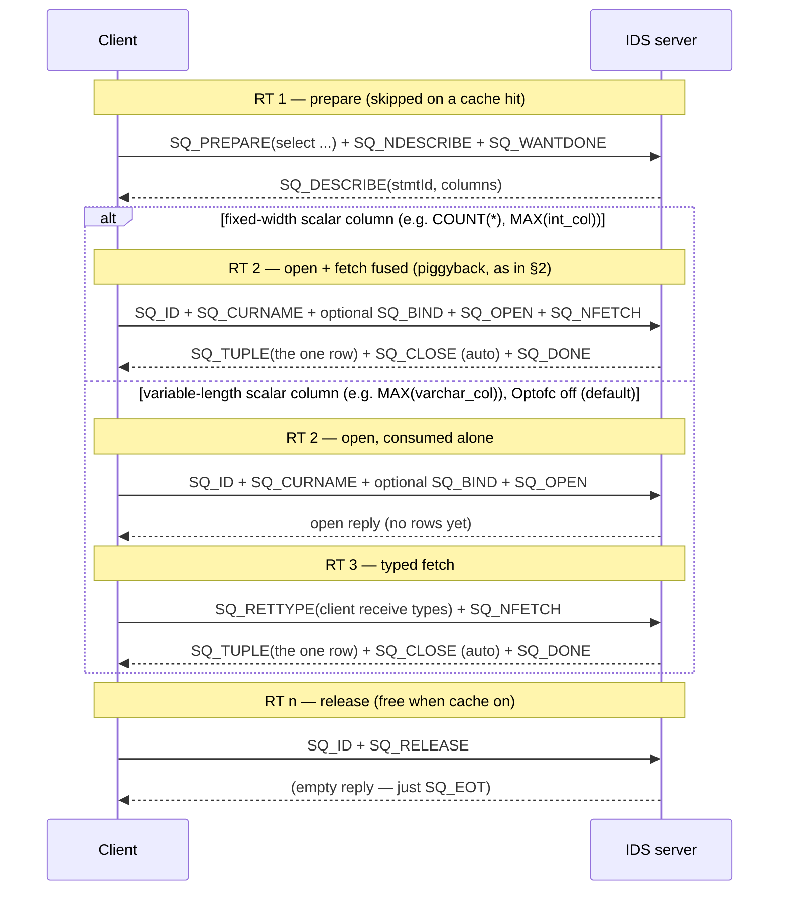

# Informix.Data — package flow on the wire

How each execution API maps onto SQLI messages, and what the two tuning switches
(`OPTOFC`, the prepared-statement cache) change about that flow.

Notation: every client block below is one PDU, terminated by `SQ_EOT`; the server's
answer is likewise one PDU. One send + one reply = one **round trip (RT)**, which is
the unit that costs latency. Sources: `Informix.Data/Sqli/SqliSession.cs`,
`Informix.Data/IfxBatch.cs`, `Informix.Data/IfxRowBatch.cs`,
`Informix.Data/IfxBulkLoader.cs`, `Informix.Data/docs/wire-protocol.md`.

---

## 1. Plain — two inserts

### Parameterized (`insert into t values(?)`), cache off

Three round trips per insert, six in total.

With the cache **on**: insert 1 pays prepare (miss) + execute = 2 RTs and the release
is free; insert 2 is a cache hit (`Activate`, zero wire) + execute = 1 RT. **3 RTs total.**

### Parameterless, cache off, no `Prepare()`

The fused one-round-trip path (`IfxCommand.ExecuteNonQuery` →
`SqliSession.ExecuteImmediate`) — prepare, execute and release are a single opcode
sequence with no statement id to reuse. **2 RTs for two inserts.**

---

## 2. Plain — two queries

Per query, cache off, fixed-width row. The first fetch **piggybacks the same PDU as
`SQ_OPEN`**, so one round trip opens the cursor and delivers the first tuple buffer.
When the result fits that buffer the server appends `SQ_CLOSE` (auto-close at end of
rows), so the explicit close costs nothing.

Best case per query: prepare + open/fetch + release = 3 RTs, so **6 RTs for two
queries**; with the cache on and warm, **1 RT per query**. Variable-length rows are
where `OPTOFC` starts to matter — see §6.

---

## 3. `IfxRowBatch` — one statement, N value rows

`Execute()` → `SqliSession.ExecuteBatch`. `SQ_ID` is sent **once**, then bind+execute
repeats per row inside the same PDU. When the outgoing PDU approaches ~32 KB it is
flushed, the replies consumed, and the chain restarts with a fresh `SQ_ID`.

So 1000 small inserts cost a prepare plus a handful of 32 KB round trips instead of
1000+.

---

## 4. `IfxBatch` (`DbBatch`) — heterogeneous statements

`ExecuteNonQuery` pipelines through `SqliSession.ExecuteChain`. Phase 1: each
**distinct** parameterized statement not already in the cache costs its own prepare RT
— deliberately not chained, because the driver must inspect `DescribesResultSet`
before it can decide the statement is safe to run. Phase 2: everything executes behind
**one flush**, mixing two segment shapes in a single PDU.

Parameterless commands ride as inline `SQ_COMMAND` segments, parameterized ones as
`SQ_ID + SQ_BIND + SQ_EXECUTE` against their prepared ids. On the first error the
server aborts the rest of the PDU fail-fast — nothing further arrives, and unsent
segments are never sent. With a warm cache, a batch of N different DML statements is
**1 RT total**.

`IfxBatch.ExecuteReader` is *not* pipelined: one open per command as `NextResult`
advances, forced by the single-open-cursor-per-session rule.

---

## 5. `IfxBulkLoader` — native insert cursor

Buffered mode plus an all-fixed-width INSERT selects the `SQ_PUT` engine; anything
else (a variable-length column, an EXECUTE PROCEDURE, `PlainInserts` mode) falls back
to the §3 bind/execute chain.

Rows travel as **raw fixed-width tuple images with no per-row type words** — denser
than `SQ_BIND`, which re-sends type, indicator and precision for every value of every
row. A flush PDU fills up to the insert buffer (`FET_BUF_SIZE`, else ~32 KB), and
`nrows` caps at 32 767. Two live-verified traps: a **non-hold** open on a logged
database needs an active transaction (-255), and commit/rollback closes a non-HOLD
cursor server-side — so the loader flushes (commit) or drops (rollback) buffered rows
first.

---

## 6. `OPTOFC` 0 vs 1

Off by default (`Optofc`). It only affects opening a **forward-only cursor over a
prepared SELECT or EXECUTE PROCEDURE with a variable-length row** — fixed-width rows
already piggyback the fetch either way, and scroll cursors never qualify. Port of the
JDBC `IfxSqliConnect.optofc` branch, extended to EXECUTE PROCEDURE because IDS accepts
the merged PDU for it verbatim.

With OFC on, the `SQ_RETTYPE + SQ_NFETCH` pair rides in the same PDU as `SQ_OPEN`, so
the first tuple buffer comes back with the open reply — one round trip saved per
query. The `GetParameters` perf baseline measured exactly this cost.

---

## 7. Prepared-statement cache on vs off

`PreparedStatementCacheSize` changes which of the three phases touch the wire:

| Phase | Cache off | Cache on |
|---|---|---|
| Prepare | `SQ_PREPARE + SQ_NDESCRIBE + SQ_WANTDONE` — 1 RT, every time | Hit: `Activate`, **zero wire**. Miss: normal prepare RT |
| Execute | `SQ_ID + [SQ_BIND] + SQ_EXECUTE` — 1 RT | Identical — 1 RT |
| Release | `SQ_ID + SQ_RELEASE` — 1 RT | Return to cache, **zero wire** (LRU evictee gets a real release) |

A repeated parameterized statement therefore drops from **3 RTs to 1**.

Semantics the diagram cannot show:

- The cache key is (SQL text, scroll, hold) — the same text opened as a scroll or hold
  cursor needs its own prepared statement.
- **Checkout removes** the entry, so concurrent identical SQL never races over one
  handle: the second user simply prepares its own copy.
- A **-710 stale-plan** failure releases the handle for real instead of returning the
  poisoned plan to the cache.
- One behavioral flip: with the cache on, even *parameterless* `IfxCommand` statements
  abandon the fused 1-RT `SQ_COMMAND` path (it has no statement id to cache). A
  one-shot statement costs 2 RTs, but every repeat is 1 RT with no server-side
  re-parse.

---

## 8. `EXECUTE PROCEDURE` — parameterized, single-row result with VARCHAR columns

Same code path as §2 (`ExecuteReaderCore` → `OpenCursor`, since `StatementType ==
ExecProc` with output columns satisfies `DescribesResultSet` exactly like a SELECT).
`OPTOFC` now covers `StatementType == Select` **or** `ExecProc` —
`bool optofc = Optofc && StatementType is Select or ExecProc` — extended beyond the
reference JDBC driver's `Select`-only gate because IDS 9.61 accepts the merged PDU for
EXECUTE PROCEDURE verbatim (§6). A VARCHAR output column
also sets `_rowNeedsWalk = true`; with `Optofc` off that forces the open reply to be
consumed on its own before `SQ_RETTYPE + SQ_NFETCH` can be sent, but with `Optofc` on
the `if (_rowNeedsWalk && !optofc)` guard never fires, so the pair rides in the same
PDU as `SQ_OPEN` exactly like §6's variable-length SELECT case.

**4 RTs cold with `Optofc` off** (prepare, open, typed-fetch, release); **3 RTs cold
with `Optofc` on** (prepare, open+fetch fused, release) — the same floor as the
equivalent SELECT in §6. With the prepared-statement cache on and warm (§7), prepare
and release both go free, leaving **2 RTs per call off / 1 RT per call on** —
matching the fixed-width-column floor without needing a schema change.

Cache the statement (§7) on top of this for the biggest win: it removes 2 of the 4
RTs on every repeat call regardless of `Optofc` or the procedure's column types.

---

## 9. `ExecuteScalar()` — first column of the first row

`IfxCommand.ExecuteScalar` has no dedicated wire opcode: it's `using var reader =
ExecuteReader(); return reader.Read() ? reader.GetValue(0) : null`, so it rides the
exact §2 cursor-open path. The only thing scalar about it is that the query happens to
answer one row — which means `NextRow()` never has to fetch again (the row `OpenCursor`
already buffered is the only one), and the server's auto-close piggybacks on the same
reply that carries that row.

**3 RTs cold** for a fixed-width scalar (prepare, open/fetch, release) — **1 RT** once
the statement is cached and warm. A variable-length scalar costs **4 RTs cold / 2 RTs
cached** with `Optofc` off, the same split §6 describes for any SELECT with a
variable-length row.

`ExecuteScalar` over a genuine SELECT qualifies for `Optofc`
(`StatementType == Select` is one of the two statement types the gate accepts,
alongside `ExecProc` per §8) — so turning it on fuses RT 2/3 back into one PDU even
for a variable-length column, matching the fixed-width row: **3 RTs cold / 1 RT
cached-and-OPTOFC-on**, same floor as the fixed-width case.

---

## How the options compose

`OPTOFC` saves one round trip per variable-length query open. The cache saves the
prepare and release round trips around it. The three batch APIs collapse the execute
phase itself — `IfxRowBatch` for one statement over many rows, `IfxBatch` for many
statements behind one flush, `IfxBulkLoader` for the densest raw-tuple stream.

Best case for a repeated variable-length SELECT with both switches on is a **single
round trip**: open plus first buffer, with prepare and release both free.
