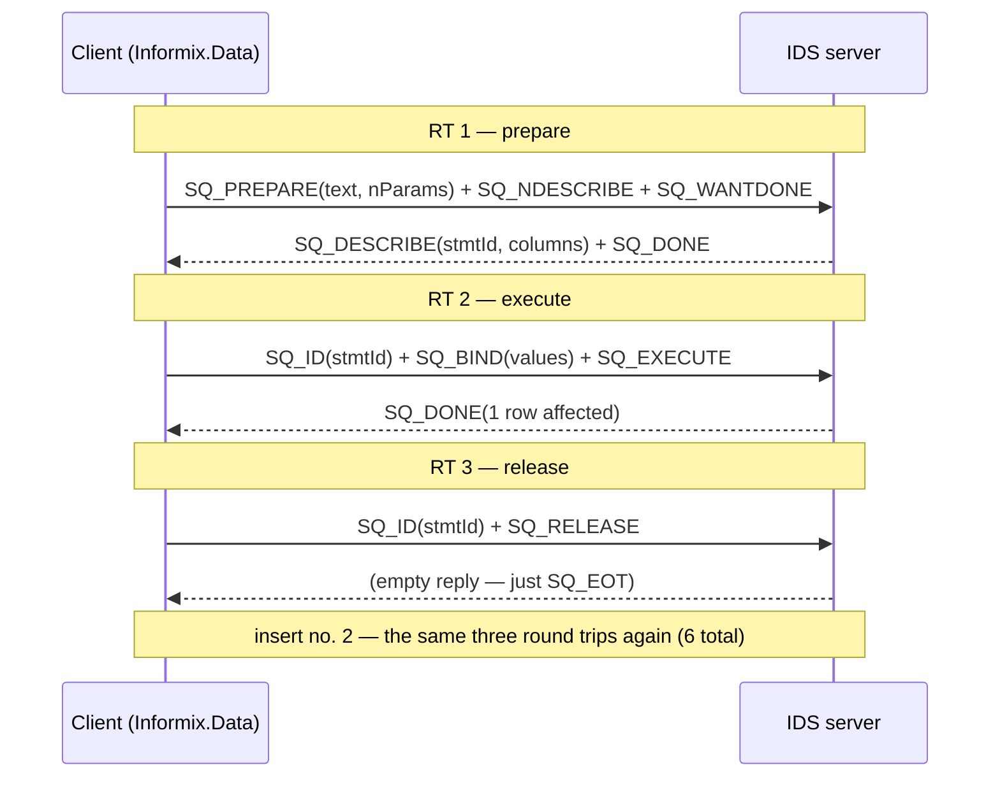
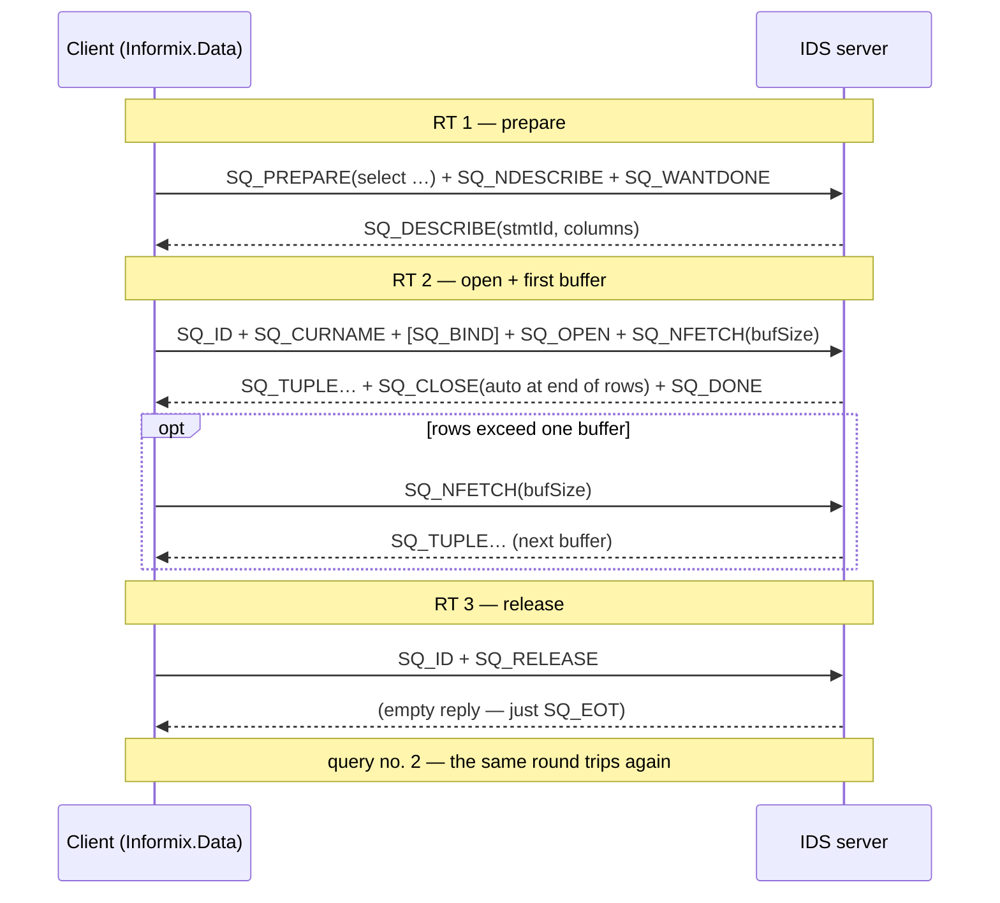
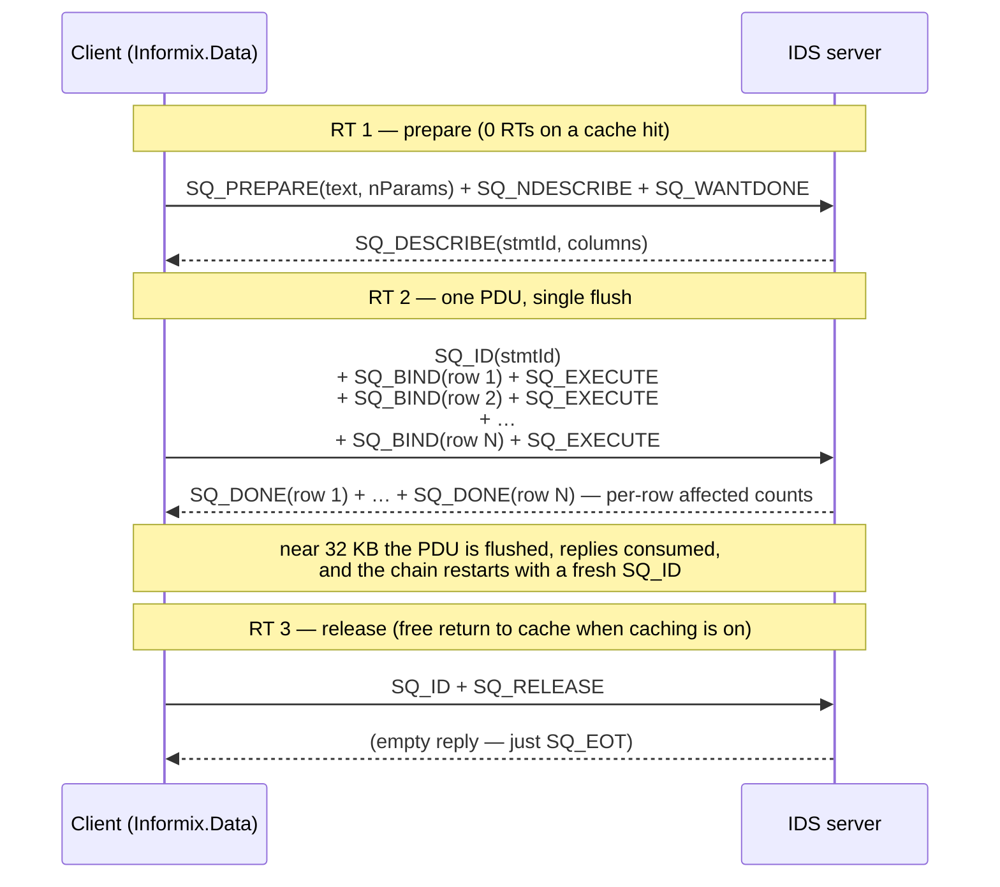
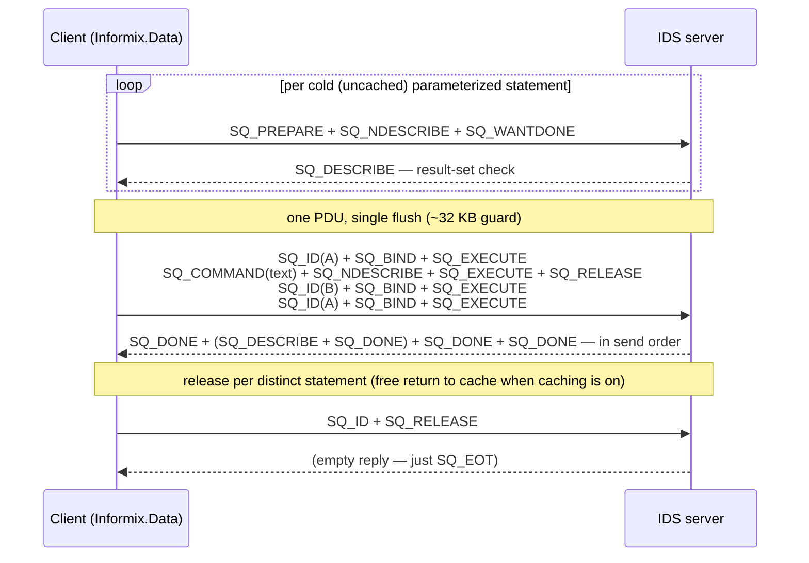
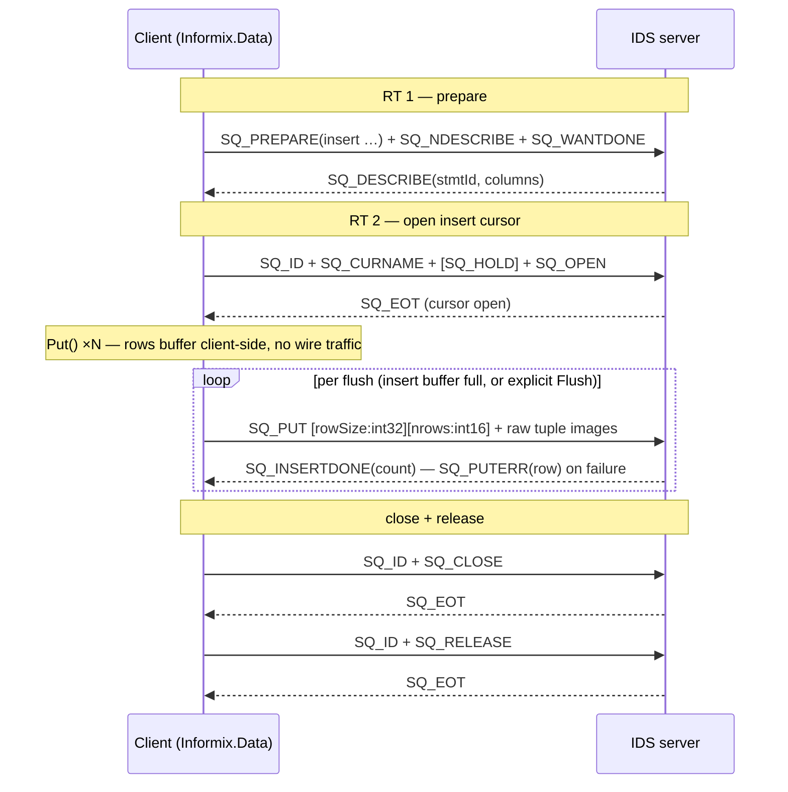
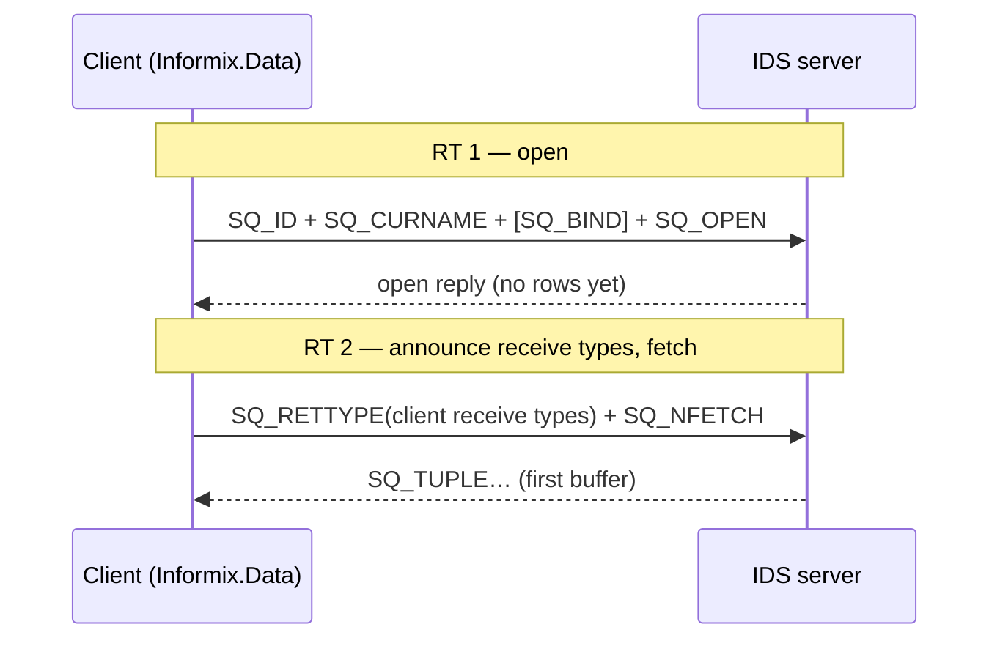
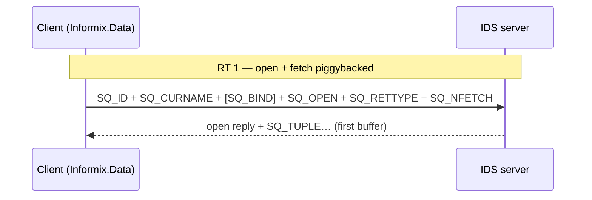
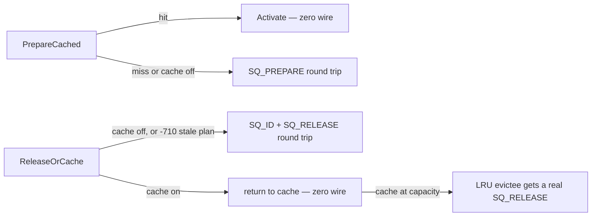

# Informix.Data — SQLI message flows per execution API

How each execution API of the driver travels on the wire, compared: a plain
`IfxCommand` (two inserts, two queries), `IfxRowBatch`, `IfxBatch`,
`IfxBulkLoader`, plus what the `Optofc` switch and the prepared-statement
cache change. Companion to [wire-protocol.md](wire-protocol.md) (framing,
encodings, traps) — this file is only about *which messages, in which round
trips*.

Notation: each `→` block is one client PDU (always terminated by `SQ_EOT`),
each `←` block is the server reply PDU; one `→`/`←` pair = one round trip
(RT). In the diagrams, solid arrows are client PDUs, dashed arrows are server
replies.

## 1. Plain: two inserts (`IfxCommand.ExecuteNonQuery` ×2)

**Parameterless, cache off** — the one-round-trip `SQ_COMMAND` path
([IfxCommand.cs:404](../IfxCommand.cs)): prepare/execute/release are fused
into one opcode sequence, there is no statement id to reuse. **2 RTs total.**

```
→ SQ_COMMAND(0, "insert into t values(1)") + SQ_NDESCRIBE + SQ_EXECUTE + SQ_RELEASE + SQ_EOT
← SQ_DESCRIBE + SQ_DONE [+ SQ_COST] + SQ_EOT
→ SQ_COMMAND(0, "insert into t values(2)") + SQ_NDESCRIBE + SQ_EXECUTE + SQ_RELEASE + SQ_EOT
← SQ_DESCRIBE + SQ_DONE + SQ_EOT
```

**Parameterized (`insert into t values(?)`), cache off** — 3 RTs per insert,
6 total:



**Same, cache on** — insert 1: prepare (miss) + execute = 2 RTs,
return-to-cache is free; insert 2: cache hit (`Activate`, zero wire) +
execute = 1 RT. **3 RTs total.**

## 2. Plain: two queries (`ExecuteReader` ×2)

Per query (cache off, fixed-width row):



For **fixed-width rows** the first fetch piggybacks in the same PDU as
`SQ_OPEN` — one RT opens the cursor *and* delivers the first tuple buffer.
When the result fits one buffer the server appends `SQ_CLOSE` (auto-close at
end of rows, [SqliSession.cs:2326](../Sqli/SqliSession.cs)), so the explicit
close costs nothing. Best case per query: prepare + open/fetch + release =
3 RTs → **6 RTs for two queries**; with cache on and warm: **1 RT per
query**.

**Variable-length rows** (any walked row — VARCHAR, DECIMAL, DATETIME…) are
where OFC matters — see §6.

## 3. `IfxRowBatch` — one statement, N value rows

`Execute()` → `SqliSession.ExecuteBatch`
([SqliSession.cs:552](../Sqli/SqliSession.cs)). `SQ_ID` is sent **once**,
then bind+execute repeats per row, all in one PDU:



So 1000 small inserts ≈ prepare + a handful of 32 KB round trips, instead of
1000+.

## 4. `IfxBatch` (DbBatch) — heterogeneous statements

`ExecuteNonQuery` pipelines via `ExecuteChain`
([SqliSession.cs:612](../Sqli/SqliSession.cs)). Phase 1: each **distinct**
parameterized statement not found in the cache costs its own prepare RT
(deliberately not chained — the driver must see `DescribesResultSet` before
deciding it is safe to run). Phase 2: everything executes behind **one
flush**, mixing two segment shapes — parameterless commands ride as inline
`SQ_COMMAND` segments, parameterized ones as `SQ_ID + SQ_BIND + SQ_EXECUTE`
against their prepared ids:



On the first error the server aborts the rest of the PDU fail-fast — nothing
further arrives, and unsent segments are never sent. With a warm cache, a
batch of N different DML statements = **1 RT total**. Note `ExecuteReader` on
IfxBatch is *not* pipelined — one open per command as `NextResult` advances.

## 5. `IfxBulkLoader` — native insert cursor

Buffered mode + all-fixed-width INSERT selects the `SQ_PUT` engine; otherwise
it falls back to the §3 bind/execute chain. The native flow:



Rows travel as **raw fixed-width tuple images with no per-row type words** —
denser than `SQ_BIND`, which re-sends type/indicator/precision for every
value of every row. A flush PDU fills up to the insert buffer
(`FET_BUF_SIZE`, else ~32 KB; `nrows` caps at 32 767). Two live-verified
traps: a **non-hold** open on a logged database needs an active transaction
(-255), and commit/rollback closes a non-HOLD cursor server-side, so the
loader flushes (commit) or drops (rollback) buffered rows first.

## 6. OFC 0 vs 1 (`Optofc`, default 0)

Only affects **opening a forward-only cursor over a prepared SELECT or EXECUTE
PROCEDURE with a variable-length row** (fixed-width rows already piggyback the
fetch either way; scroll cursors never qualify — `OpenScrollCursor` doesn't
gate on `Optofc` at all). Port of JDBC `IfxSqliConnect.optofc`
([SqliSession.cs:927](../Sqli/SqliSession.cs)), extended to EXECUTE PROCEDURE
because IDS accepts the merged PDU for it verbatim (live-verified 2026-08-03).

`Optofc = false` — two round trips to the first row:



`Optofc = true` — one round trip; the `SQ_RETTYPE + SQ_NFETCH` pair rides in
the same PDU as `SQ_OPEN` and the first tuple buffer comes back with the open
reply:



Measured on the GetParameters baseline (2026-07-25): leaving OFC off costs
one round trip per variable-length query open.

## 7. Statement cache on vs off (`PreparedStatementCacheSize`)

The cache ([SqliStatementCache.cs](../Sqli/SqliStatementCache.cs)) changes
which of the three phases touch the wire:

| Phase | Cache off | Cache on |
|---|---|---|
| Prepare | `SQ_PREPARE + SQ_NDESCRIBE + SQ_WANTDONE` RT, every time | Hit: `Activate` — **zero wire**. Miss: normal prepare RT |
| Execute | `SQ_ID + [SQ_BIND] + SQ_EXECUTE` RT | identical |
| Release | `SQ_ID + SQ_RELEASE` RT | Return-to-cache — **zero wire** (LRU evictee gets a real release) |



So a repeated parameterized statement drops from 3 RTs to 1. Semantics worth
knowing: the key is (SQL text, scroll, hold); **checkout removes** the entry,
so concurrent identical SQL just prepares a second copy instead of racing; a
-710 stale-plan failure releases the handle for real instead of returning the
poisoned plan to the cache. One subtle flip: with the cache on, even
*parameterless* `IfxCommand` statements take the prepared path (the fused
`SQ_COMMAND` sequence has no statement id to cache) — a one-shot
parameterless statement costs 2 RTs instead of 1, but every repeat is 1 RT
with no server-side re-parse. The cache is also what makes IfxBatch's
pipelining pay off: with it off, every batch run re-pays one prepare RT per
distinct parameterized statement before the single execute PDU.
